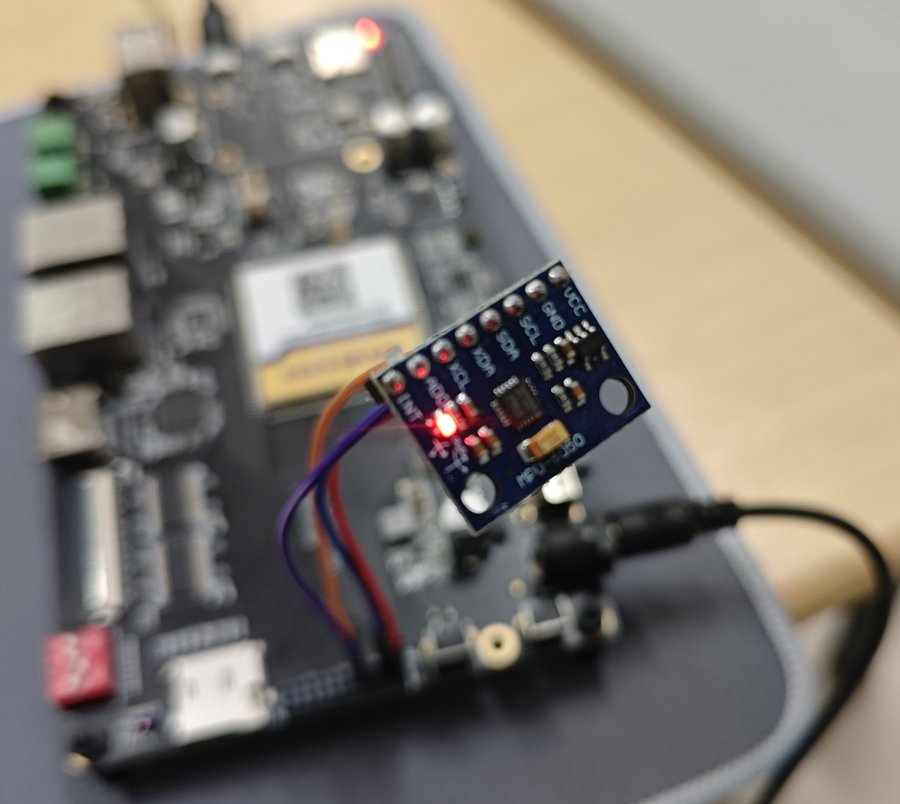
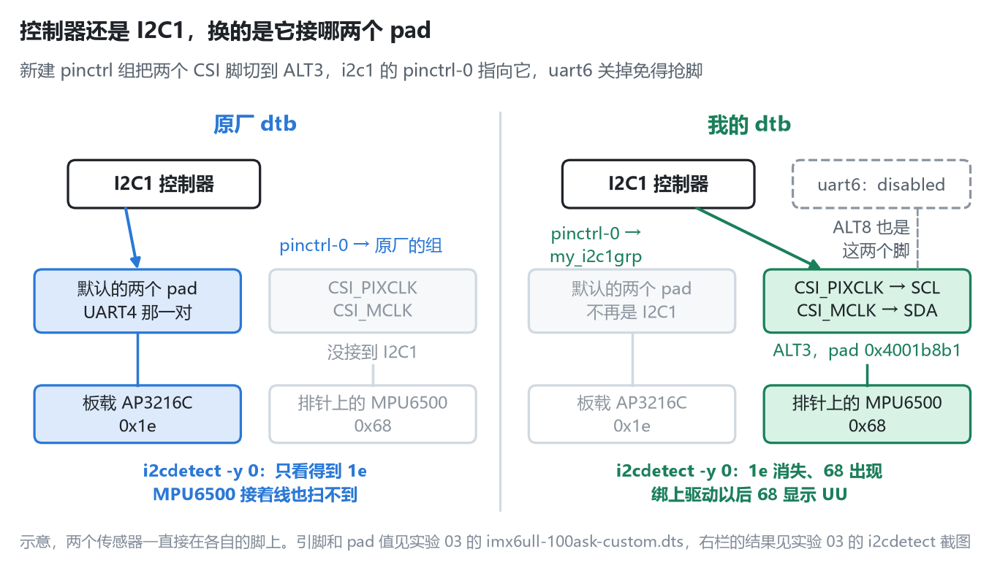
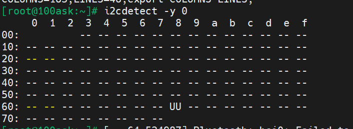
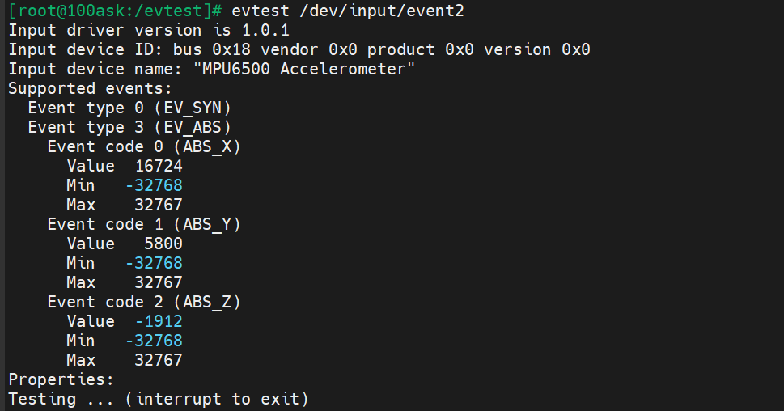
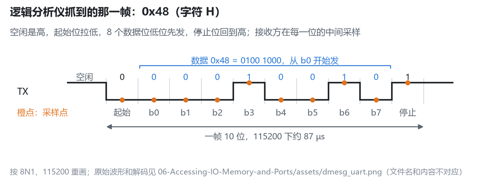
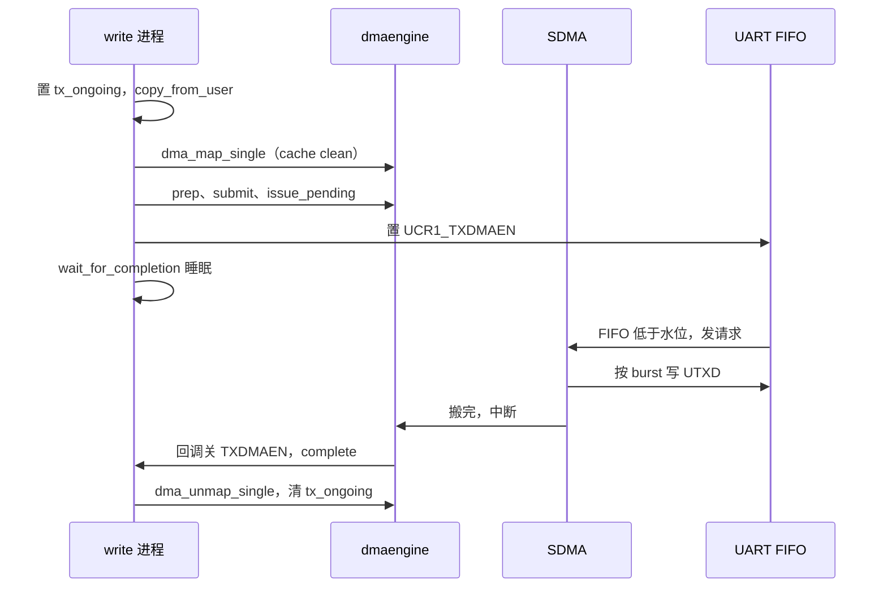
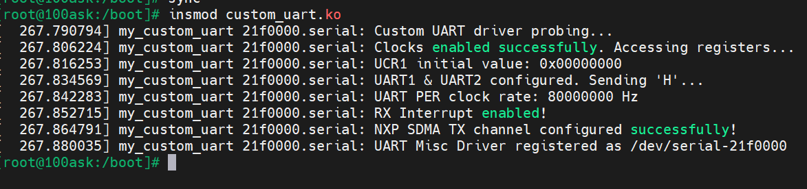

# i.MX6ULL Linux 驱动开发与平台适配

把 [Bootlin](https://bootlin.com/training/kernel/) 基于 AM335x 的 Linux 内核驱动实验移植到 100ask i.MX6ULL Pro（单核 Cortex-A7，Linux 4.9.88），驱动代码自己写。课程用的是 TI 的板子和 Nunchuk 手柄，这里换成 i.MX6ULL 和 MPU6500 加速度计，引脚、寄存器、DMA 这些和硬件有关的部分都对照 NXP 手册重写，打通设备树、I2C 总线、中断到 DMA 的链路。

分两条线：

- **MPU6500**：设备树把 I2C1 复用到摄像头排针的两个脚 → 自己写 i2c_driver → 接入 input 子系统；
- **UART4**：让内核的串口驱动放手，从寄存器写起 → misc 字符设备 → 中断接收 → 发送改成 SDMA。

| 部分 | 做了什么 | 怎么验证 |
|---|---|---|
| [引脚复用与设备树](#1-引脚复用与设备树)<br>[dts](03-Configuring-Pin-Muxing/code/imx6ull-100ask-custom.dts) | I2C1 改走 CSI_PIXCLK、CSI_MCLK（ALT3），pad 配开漏、上拉和 SION，关掉同引脚的 UART6；查出 `no groups defined` 和 inv-mpu6050 probe `-22` | `i2cdetect -y 0`：0x68 显示 UU |
| [MPU6500 驱动](#2-mpu6500-驱动)<br>[i2c](04-Using-the-I2C-Bus/code/invensense_mpu6500_i2c.c) · [input](05-Input-Interface/code/invensense_mpu6500_input.c) | 校验 WHO_AM_I，`i2c_transfer` 两条消息连读三轴，按大端拼接，接入 input 子系统 | evtest 读到三轴 |
| [UART 字符设备](#3-uart-字符设备)<br>[custom_uart.c](09-Locking/code/custom_uart.c) | platform 加 misc，实现 read、write、ioctl；接收用中断、环形缓冲和等待队列，`spin_lock_irqsave` 防死锁 | 逻辑分析仪解出 0x48；TX、RX 短接回环，接收中断 25 次 |
| [SDMA 发送](#4-sdma-发送)<br>[custom_uart_dma.c](10-DMA/code/custom_uart_dma.c) | dmaengine 把发送从 TI EDMA 改到 SDMA，置 TXDMAEN 启动，`dma_map_single` 流式映射，拿不到通道回退轮询 | dmesg：SDMA 通道配置成功 |

<p align="center">
  
</p>

目录：[1. 引脚复用与设备树](#1-引脚复用与设备树) · [2. MPU6500 驱动](#2-mpu6500-驱动) · [3. UART 字符设备](#3-uart-字符设备) · [4. SDMA 发送](#4-sdma-发送) · [5. 从 AM335x 到 i.MX6ULL](#5-从-am335x-到-imx6ull) · [6. 回头看会怎么改](#6-回头看会怎么改) · [7. 实验索引](#7-实验索引) · [8. 构建和运行](#8-构建和运行)

## 1. 引脚复用与设备树

I2C1 默认的两个 pad 接着板载的 AP3216C 光照传感器（地址 0x1e），后面的 UART 实验还要把这对 pad 当 UART4 用。MPU6500 外接在摄像头排针上，查引脚复用表，CSI_PIXCLK、CSI_MCLK 两个脚的 ALT3 正好是 I2C1。

做法是在官方的 `100ask_imx6ull-14x14.dts` 上用 `&label` 覆盖，不改原厂文件，dtc 编出一个完整的 dtb，U-Boot 里把 `fdt_file` 指过去：

- `&iomuxc` 里新建引脚组，把两个脚切到 I2C1；
- 这两个脚的 ALT8 是 UART6，把 `&uart6` 设成 disabled，免得两个外设抢同一个脚；
- `&i2c1` 的 `pinctrl-0` 换成新组，时钟 100 kHz，下面挂 `mpu6500@68`。

<picture>
  <source media="(prefers-color-scheme: dark)" srcset="docs/figures/pinmux_dark.png">
  
</picture>

pad 值 `0x4001b8b1` 是 NXP 给 I2C 的配置（原厂用的 `0x4001b8b0`）再打开快速 slew。I2C 是线与总线，器件只能拉低，高电平靠上拉，所以要开漏；SION 让控制器发送时也能读回 pad 上的电平，仲裁、读 ACK 都靠它。

| 位 | 值 | 含义 |
|---|---|---|
| 30 | 1 | SION，不在 pad 寄存器里，pinctrl 驱动把它写进 mux 寄存器 |
| 16 | 1 | HYS，输入迟滞 |
| 15–14 | 10 | PUS，100K 上拉 |
| 13、12 | 1、1 | PUE、PKE：打开上拉（不是 keeper） |
| 11 | 1 | ODE，开漏 |
| 7–6 | 10 | SPEED，中速 |
| 5–3 | 110 | DSE，驱动强度 |
| 0 | 1 | SRE，快速 slew |

**遇到的问题**

- **`no groups defined`，I2C1 控制器起不来。** 换上新 dtb 后 dmesg 报 `no groups defined`，接着 i2c 控制器 probe 返回 -22，`/dev/i2c-0` 也没了。先看 `/sys/firmware/devicetree/base/model`，确认跑的是新 dtb；再试只加 mpu6500 子节点、不动 `&iomuxc`，总线是好的，问题缩到新加的引脚组。这一版 pinctrl 驱动把 `iomuxc` 的第一层子节点当 function、第二层才当 group，我的组直接放在第一层，被当成了 function，下面自然找不到 group。原厂的组都放在一个 `imx6ul-evk` 节点下面，照着套一层就好了（新内核和新的设备树也有单层的写法）：

  ```dts
  &iomuxc {
      my_board_grp {                          /* 第一层：function */
          pinctrl_my_i2c1: my_i2c1grp {       /* 第二层：group */
              fsl,pins = <
                  MX6UL_PAD_CSI_PIXCLK__I2C1_SCL   0x4001b8b1
                  MX6UL_PAD_CSI_MCLK__I2C1_SDA     0x4001b8b1
              >;
          };
      };
  };
  ```

- **内核自带的 inv-mpu6050 probe 返回 -22。** 总线上能扫到 68，驱动却绑不上：`probe of 0-0068 failed with error -22`。这个驱动按数据就绪中断设计，初始化 trigger 时要拿中断号。INT 脚没接，就在节点里补上 `interrupt-parent` 和 `interrupts` 当占位，probe 通过，68 变成 UU；再用 [mpu_monitor.sh](03-Configuring-Pin-Muxing/code/mpu_monitor.sh) 从 IIO 的 sysfs 读 `in_accel_*_raw`，确认数据是活的。



`i2cdetect -y 0`（这块板子上总线 0 就是 I2C1）：0x68 显示 UU，说明有驱动绑定；0x1e 不见了，说明 I2C1 已经不在默认的 pad 上。

## 2. MPU6500 驱动

先用内核自带的 inv-mpu6050（IIO 驱动）确认硬件是好的，再把设备树和驱动里的 compatible 都改成 `my,custom-mpu6500`。自带驱动不再认这个节点，i2cdetect 回到 68（没有驱动绑定），insmod 自己的模块才进 probe。

- **probe**：先读 WHO_AM_I（0x75），MPU6500 固定返回 0x70，不对就返回 `-ENODEV`，免得对着别的器件写；再把 PWR_MGMT_1（0x6B）写 0，把芯片从上电默认的休眠里叫醒。remove 写 0x40，让它回到休眠。
- **读三轴**：一次 `i2c_transfer` 发两条消息，先写寄存器地址 0x3B，重复起始后连读 6 个字节。中间不发停止，总线不释放；6 个字节一次读完，X、Y、Z 是同一次采样。

  ```text
  msg[0]  S  | 0x68+W | A | 0x3B | A |
  msg[1]  Sr | 0x68+R | A | XH | A | XL | A | YH | A | YL | A | ZH | A | ZL | N | P
  ```

  S 起始，Sr 重复起始，A 应答，N 不应答，P 停止。地址和寄存器后面的 A 是 MPU6500 给的；读数据时每个字节由主机应答，最后一个字节主机不应答，告诉从机别再发了。
- **大端拼接**：高字节在前，`(data[0] << 8) | data[1]` 赋给 `short`。拼的是总线上的字节顺序，和 CPU 的大小端无关；直接把缓冲强转成 `short *`，在小端的 ARM 上就读反了。
- **接入 input 子系统**：4.9 上用 `input_polled_dev`（新内核已经删掉，改用 `input_setup_polling`），`poll_interval` 设 50 ms，回调里 `input_report_abs` 报 X、Y、Z，再 `input_sync`；范围 −32768 到 32767，fuzz 8。回调跑在 delayed work 里，是进程上下文，可以调用会睡眠的 `i2c_transfer`。加速度计的正统归宿是 IIO，接 input 是沿用课程（Nunchuk 本来就是输入设备）的路线。

验证：insmod 后 dmesg 打出 `input: MPU6500 Accelerometer as .../21a0000.i2c/i2c-0/0-0068/input/input2`；`/proc/bus/input/devices` 里 `EV=9`（EV_SYN 加 EV_ABS），`ABS=7`（X、Y、Z）；evtest 列出三个轴的当前值和范围，数值随板子摆放变化。evtest 是用 `arm-linux-gnueabihf-gcc -static` 编好推到板上的。



轮询周期配的是 50 ms，按 evtest 事件的时间戳算，实际约 60 ms 一帧（推算；[完整截图](05-Input-Interface/assets/input_registered.png)下半部分的打印错位了，`value` 一栏其实是微秒时间戳）。原因推断是 HZ=100 时 delayed work 按 tick 取整，落到了第 6 个 tick。要周期准，得用传感器的数据就绪中断或者 hrtimer。

## 3. UART 字符设备

把设备树里 uart4 的 compatible 改成自己的字符串，内核的 imx-uart 驱动就不认它了；节点里的寄存器、中断、时钟这些资源还在，由自己的 platform 驱动接管。驱动在五个实验里一步步加出来，每一步都在上一步能跑的基础上：

| # | 加了什么 | 怎么验证 |
|---|---|---|
| 06 | platform 驱动、`devm_ioremap_resource`、时钟、波特率、轮询发送 | 逻辑分析仪抓到 `H` |
| 07 | misc 设备，`write`、`ioctl` | `echo`、`test_ioctl`、逻辑分析仪 |
| 08 | 接收中断、环形缓冲、等待队列、自旋锁 | TX、RX 短接回环，`/proc/interrupts` |
| 09 | 理清锁的规则，代码和 08 基本相同 | 同上 |
| 10 | 发送改成 SDMA（[第 4 节](#4-sdma-发送)） | dmesg |

- **probe 的顺序**：私有结构体、锁、寄存器映射、时钟（ipg 和 per）、等待队列、初始化 UART 和波特率、注册中断，最后 `misc_register`。中断函数要用的锁、等待队列、寄存器都在注册中断之前准备好；`misc_register` 放最后，因为一注册用户态就能进来。
- **波特率**：per 时钟 80 MHz，UBIR 写 15（和公式里的 16 抵消），UBMR 写 80 MHz ÷ 115200 − 1 = 693，参考时钟不分频，实际约 115274，偏差约 0.06%（[代码](10-DMA/code/custom_uart_dma.c#L357-L363)）。
- **misc 设备**：主设备号固定 10，次设备号动态分配（板上是 56），节点名用寄存器基地址拼成 `/dev/serial-21f0000`。open 时 `file->private_data` 指向嵌在私有结构体里的 `miscdevice`，用 `container_of` 找回整个结构体。
- **write 和 ioctl**：`kzalloc`、`copy_from_user` 可能睡眠，放在锁外；然后逐字节等 TXFE 再写 UTXD，换行前补回车，等待有 1000000 次的上限，防止 FIFO 卡住时内核挂死。ioctl 清零和读取发送计数：板上读到 16，写 `test` 后是 20，清零后是 0。
- **接收**：RRDY 中断里读 URXD，在锁内写进 32 字节的环形缓冲，放锁后唤醒等待队列；`read` 睡在 `wait_event_interruptible` 上，醒来在锁内取一个字节，锁外 `put_user`。
- **锁**：`read` 和中断里都用 `spin_lock_irqsave`。如果进程用普通 `spin_lock` 拿着锁时来了接收中断，中断函数也要这把锁，就会在同一个 CPU 上一直自旋，而进程被它压着放不了锁，死锁。单核上锁实际防的是中断和抢占，写上它，代码放到多核上也成立。

**遇到的问题**

- **发送没有波形。** probe 正常，dmesg 说发送成功，逻辑分析仪上却是一条直线。一层层查：先是接错了针，排针 8 脚是摄像头复位，UART4_TX 在 10 脚；再看寄存器，UCR2 没置 IRTS（忽略 RTS），没接流控线时发送器一直在等；UBIR、UBMR 也没配，波特率发生器没有分频值。都改掉以后抓到了波形，PulseView 解码出 0x48，正是 probe 里发的 `H`。

  <picture>
    <source media="(prefers-color-scheme: dark)" srcset="docs/figures/uart_frame_dark.png">
    
  </picture>

- **接收中断计数一直是 0。** TX、RX 用杜邦线短接，后台 `cat`，前台 `echo` 一串字符，`cat` 没反应，`/proc/interrupts` 的计数是 0。先发现 UCR2 没开 RXEN，补上还是 0；中断注册了、RRDYEN 也开了，计数还是 0，说明接收器根本没收到数据。翻手册的 UART 寄存器，UCR3 的 RXDMUXSEL（bit 2）要求必须置 1，复位值却是 0，外部 RX 进不到接收器。置上以后（[代码](09-Locking/code/custom_uart.c#L299-L302)）回显出来了，`echo "Real Hardware Loopback!"` 之后计数正好是 23 个字符加回车换行：

  ```text
  # cat /proc/interrupts | grep 21f0000
   74:         25       GPC  29 Level     21f0000.serial
  ```

  截图：[回环输出](08-Sleeping-and-Handling-Interrupts/assets/cat_blocking_read.png) · [中断计数](08-Sleeping-and-Handling-Interrupts/assets/interrupt_count.png)

## 4. SDMA 发送

课程的 TI 版本用 EDMA，这里按 NXP 手册改成 SDMA，上层接口还是 dmaengine。和 TI 版本的差别在两处：

- **启动方式**：OMAP 的 UART 有个 quirk，DMA 不会自己开始，要 CPU 先手写第一个字节；i.MX 不用，置位 UCR1 的 TXDMAEN 以后，FIFO 低于水位 UART 就自动向 SDMA 发请求，所以这一段去掉了。
- **TXDMAEN 的位置**：当时查的资料写 bit 14，对照手册的 UCR1 位图，bit 14 是 ADBR（自动波特率检测），TXDMAEN 是 bit 3。

probe 里用 `dma_request_chan(dev, "tx")` 按名字取通道。返回 `-EPROBE_DEFER` 说明 SDMA 驱动还没起来，原样返回，让内核稍后再 probe；其他错误打一条 warning，退回轮询发送。UTXD 的物理地址用 `dma_map_resource` 映射成 SDMA 能用的地址，方向内存到设备，位宽 1 字节，burst 16。驱动备了两套 `file_operations`，read 和 ioctl 共用，write 分别是轮询版和 DMA 版，`misc_register` 之前按通道申请的结果选一套。

每次 write：



- **tx_ongoing 和完成量**：缓冲和通道只有一份，`tx_ongoing` 让第二个 write 直接返回 `-EBUSY`。传输要持续一段时间、进程还要睡，自旋锁不能跨过去，所以它只保护这个标志的检查和设置。完成量负责等待：回调跑在 tasklet 里不能睡，只关 TXDMAEN、`complete`；每次传输前 `reinit_completion`。
- **流式映射**：`dma_map_single(..., DMA_TO_DEVICE)` 在 ARM 上做 cache clean，SDMA 从内存读到的才是新数据；映射期间 CPU 不碰这块缓冲，完成后 unmap。用户缓冲先 `copy_from_user` 到 16 字节的内核缓冲（一次 write 最多发 16 字节，多的由用户态接着写），所以这里有一次拷贝，不是零拷贝。
- **水位和 burst**：burst 不能超过请求时 FIFO 的空位。代码没写 TXTL，用的是复位值 2（手册值，没在板上读过），请求时 32 字节的 FIFO 约有 30 个空位，burst 16 放得下。
- **回调不等于发完**：回调只说明 SDMA 把数据搬进了 FIFO，16 个字节按 115200 还要约 1.3 ms 才移空（推算）。要确认线上发完得查 USR2 的 TXDC，接 RS-485 时尤其要等它再切方向。



能直接证明的是通道配置成功（上图）。仓库里那张[回环截图](10-DMA/assets/dma_tx_callback.png)收到了 0x0d，而 DMA 写函数不转换换行，那一次走的很可能还是轮询写函数：当时 probe 末尾多了一行，把 fops 又改回了轮询版，后来删掉了，删掉以后的回环结果没留截图。所以这张图只说明回环通路是好的。也没有做吞吐和 CPU 占用的对比，这个场景（115200、一次 16 字节）选 DMA 主要是为了走通 dmaengine。

## 5. 从 AM335x 到 i.MX6ULL

驱动框架是通用的：i2c_driver、misc、dmaengine 这些接口不用变，要改的都在设备树和寄存器这一层。

| 项 | 课程（AM335x） | 这里（i.MX6ULL） |
|---|---|---|
| 引脚复用 | pinctrl-single，直接写寄存器偏移和值 | `fsl,pins`，引脚宏加 pad 值，两级节点 |
| I2C 设备 | Nunchuk 手柄 | MPU6500，先读 WHO_AM_I、写 PWR_MGMT_1 唤醒 |
| UART | OMAP 的寄存器 | UCR1–3、UFCR、UBIR、UBMR；接收要置 RXDMUXSEL |
| DMA | EDMA，CPU 手写第一个字节启动 | SDMA，置 TXDMAEN 后由 UART 自动请求 |

课程那一列按课程材料写，仓库里只有 i.MX6ULL 这边的代码。

## 6. 回头看会怎么改

复盘时发现的问题和改法。实验代码没有改，下面的改法是方案，都没上板跑过。

| 问题 | 位置 | 改法 |
|---|---|---|
| 环形缓冲没判满：写指针追上读指针，缓冲看起来又变空了，一整段数据都丢 | [ISR](09-Locking/code/custom_uart.c#L239-L240) | 写之前判满，满了丢新字节并计数 |
| 多个进程同时 read：都被叫醒、都在锁外看到非空，后一个会读到旧字节；一次只给一个字节 | [read](09-Locking/code/custom_uart.c#L163-L177) | 醒来后在锁内再判一次空；一次拷多个字节；支持 `O_NONBLOCK` |
| 没有 poll，用户态没法用 select、epoll 等数据 | — | 加 `.poll`：`poll_wait` 挂上等待队列，缓冲非空返回 `POLLIN` |
| write 持锁关中断逐字节轮询，一个字节约 87 µs，长一点的 write 期间接收中断进不来 | [write](09-Locking/code/custom_uart.c#L131-L141) | mutex 串行化 write，自旋锁只保护计数；或者改成中断、DMA 发送 |
| DMA 发送的 `wait_for_completion` 没有超时，回调不来进程就卡死 | [wait](10-DMA/code/custom_uart_dma.c#L263) | 换成带超时的版本，超时就终止传输、关 TXDMAEN、返回 `-ETIMEDOUT` |

接收也可以改成 DMA，难点是不定长。做法是循环 DMA 加空闲检测：一块环形缓冲交给 SDMA 一直收（`dmaengine_prep_dma_cyclic`），半满、全满各来一次回调；再打开 UART 的 aging 定时器，线路空闲时来中断，作用类似 STM32 的 IDLE 中断。三个时机都进同一个处理函数，用 `dmaengine_tx_status` 读 residue，算出 DMA 写到了哪，上次处理到的位置和它之间就是新数据，写位置绕回开头时分两段交给上层。接收方向要作废 cache，这块缓冲不能用 `devm_kzalloc` 分（在这版内核上它的数据区和管理头可能共用 cache line），用 `kmalloc` 或 `dma_alloc_coherent`。

## 7. 实验索引

| # | 实验 | 结果 |
|---|---|---|
| 01 | [Writing Modules](01-writing-modules/docs/README.md) | out-of-tree 模块，`module_param` 在 sysfs 里可改，打印运行时的内核版本 |
| 02 | [Describing Hardware Devices](02-Describing-Hardware-Devices/docs/README.md) | 覆盖官方 dts：LED 改成心跳，在 I2C1 上声明 `mpu6500@68` |
| 03 | [Configuring Pin Muxing](03-Configuring-Pin-Muxing/docs/README.md) | I2C1 挪到 CSI 引脚，内核的 inv-mpu6050 绑定，i2cdetect 显示 UU |
| 04 | [Using the I2C Bus](04-Using-the-I2C-Bus/docs/README.md) | 自己的 i2c_driver，WHO_AM_I 读出 0x70，probe 里读一次三轴 |
| 05 | [Input Interface](05-Input-Interface/docs/README.md) | 接入 input 子系统，evtest 读到三轴 |
| 06 | [Accessing I/O Memory and Ports](06-Accessing-IO-Memory-and-Ports/docs/README.md) | 接管 UART4，配寄存器和波特率，逻辑分析仪抓到 `H` |
| 07 | [Output-only Misc Driver](07-Output-only-Misc-Driver/docs/README.md) | `/dev/serial-21f0000`，write 和读写发送计数的 ioctl |
| 08 | [Sleeping and Handling Interrupts](08-Sleeping-and-Handling-Interrupts/docs/README.md) | 中断接收、阻塞读，回环收到 25 次中断 |
| 09 | [Locking](09-Locking/docs/README.md) | 锁的规则，代码和 08 基本相同 |
| 10 | [DMA](10-DMA/docs/README.md) | SDMA 发送，拿不到通道时回退轮询 |

## 8. 构建和运行

在 WSL2 上交叉编译，内核源码用 100ask SDK 里的 Linux 4.9.88，要先完整编译过一遍（out-of-tree 模块要用它生成的头文件和符号表）。各实验的 Makefile 默认内核源码在 `$(HOME)/100ask_imx6ull-sdk/Linux-4.9.88`，在别处就用 `make KERN_DIR=...` 指定（实验 01 的变量叫 `KDIR`）。交叉编译器是 `arm-linux-gnueabihf-`，要在 PATH 里。

**驱动模块**，在各实验的 `code/` 下：

```bash
# 实验 04–10：Makefile 里已经带了 ARCH 和 CROSS_COMPILE
make
# 实验 01：Makefile 没带，写在命令行
make ARCH=arm CROSS_COMPILE=arm-linux-gnueabihf-
```

**设备树**（实验 02、03、06）：把 `code/imx6ull-100ask-custom.dts` 放进内核源码的 `arch/arm/boot/dts/`，按 [Makefile.dts](02-Describing-Hardware-Devices/code/Makefile.dts) 把它加进 dtb 列表，在内核源码根目录编译：

```bash
make ARCH=arm CROSS_COMPILE=arm-linux-gnueabihf- dtbs
```

三份 dts 是递进的：02 声明 LED 和 MPU6500，03 加上引脚复用，06 再加 UART4 的引脚组、把 uart4 交给自己的驱动。实验 04、05 要把 mpu6500 节点的 compatible 改成 `my,custom-mpu6500`；实验 07–10 的驱动认的是 `my,custom-uart4`，06 的 dts 里写的是 `my,custom-uart`，要跟着改。这两处改动当时没单独存进仓库。

**部署**：dtb 和 ko 用 `adb push` 推到板子的 `/boot`。第一次换 dtb 时在 U-Boot 里改启动用的设备树：

```text
=> setenv fdt_file imx6ull-100ask-custom.dtb
=> saveenv
=> reset
```

启动后 `cat /sys/firmware/devicetree/base/model` 显示 dts 里改过的 model 字符串，说明跑的是新 dtb；然后 `insmod`，看 `dmesg`。用户态的测试程序（[test_ioctl.c](07-Output-only-Misc-Driver/code/test_ioctl.c)、evtest）静态编译后推上去：

```bash
arm-linux-gnueabihf-gcc -static test_ioctl.c -o test_ioctl
```

## 仓库结构

```text
linux-kernel-driver-labs/
├── 01-writing-modules/ … 10-DMA/
│   ├── code/        驱动源码、Makefile、设备树、测试程序
│   ├── docs/        实验文档
│   └── assets/      板上的截图和照片
└── docs/figures/    README 的图和生成脚本（python3 docs/figures/make_figures.py）
```

## License

内核模块以 [GPL-2.0](LICENSE) 发布。
